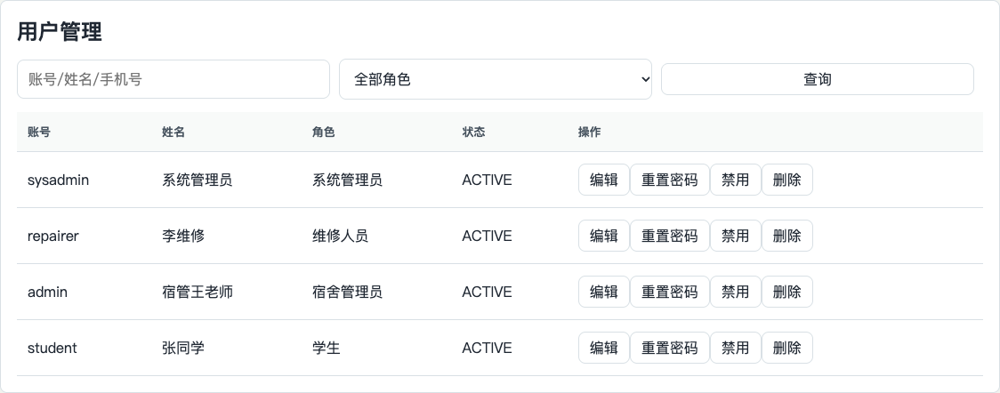

# 实验一 Web 基础项目与用户 CRUD

姓名：________　学号：________　班级：________　实验日期：________

本实验以高校宿舍报修系统为载体，验证 Spring Boot Web 项目的分层实现、MySQL 数据源、用户增删改查及 jar 部署。使用现有业务工程完成实验，不另建重复项目。

## 实验目标与环境

- Java 17、Spring Boot 3.3.5、Maven 3.9.9、MyBatis-Plus 3.5.7。
- MySQL；本次验证使用独立测试实例，实际版本见验证记录。
- 系统管理员负责用户管理；普通学生不能调用用户管理接口。

## 操作步骤

1. 检查 `backend/pom.xml` 中 Web、Validation、MyBatis-Plus 和 MySQL 依赖。
2. 在独立空数据库执行 `database/init.sql`。已有业务数据库只执行 `database/migrations/002_permissions.sql`，不执行带删除表语句的初始化脚本。
3. 设置 `DB_URL`、`DB_USER`、`DB_PASSWORD` 和 `JWT_SECRET`。应用从环境读取连接密码与签名密钥。
4. 执行 `mvn verify`；通过后执行 `java -jar target/dorm-repair-backend-1.0.0.jar`。
5. 登录 `sysadmin`，新增临时学生用户；按账号查询，修改姓名，再删除该用户并查询确认删除结果。
6. 执行 `python3 scripts/verify_api.py --base http://localhost:8080/api --allow-write` 复验。该脚本会创建测试数据，应使用独立实验数据库。

## 关键代码说明

| 层次 | 文件 | 职责 |
|---|---|---|
| Entity | `User.java` | 数据表映射；密码哈希使用 JsonIgnore 防止序列化返回 |
| Mapper | `UserMapper.java` | MyBatis-Plus 基础 CRUD 和分页查询；动态 SQL 使用参数绑定 |
| Service | `UserAdminService.java` | BCrypt、角色有效性、状态校验、事务和最后一个管理员保护 |
| Controller | `UserController.java` | JSON 请求、参数校验和接口权限声明 |
| 数据源 | `application.yml` | 环境变量配置；运行时读取数据库密码 |

创建用户时使用 `passwordEncoder.encode()` 保存 BCrypt 哈希。Controller 处理 HTTP，Service 处理业务约束，Mapper 访问数据库。写操作的 `@Transactional` 使业务更改与操作日志处于同一事务中。

## 测试及操作截图

- 自动化用例：`backend/src/test/java/com/dormrepair/UserAdminServiceTest.java`。
- 真实用户 CRUD、报修闭环及 HTTP 状态见 [接口验证记录](../evidence/api-verification.json)。
- 构建和测试统计见 [验证总表](../验证结果.md)。

本次实际结果：后端19项自动测试通过，独立MySQL上24项HTTP检查通过，浏览器9项检查通过，前后端构建及jar启动通过。完整统计保存在同目录上级的验证材料中。

## 总结与反思

有源码和 jar 并不等于已通过验收，应将构建测试与真实数据库联调分开验证。用户管理不能只判断前端菜单可见性，接口必须再次校验权限。删除最后一个管理员和编辑管理员角色属于不同入口，需要在 Service 层统一保护。测试用户使用独立数据，避免影响原有业务数据。

## 本人应能讲解的内容

解释 Controller、Service、Mapper 的调用关系；说明 BCrypt 为什么不能反向解密；展示四个 CRUD 接口及其请求字段；说明事务失败时的回滚行为。

## AI 工具使用记录

本次补充使用 Codex。使用环节包括缺口核对、认证配置、测试代码、接口说明与报告整理。主要任务指令为“补齐个人实验一、二、四，排除实验三和五”，并要求保留报修业务、使用真实运行结果。新增关键实现及测试包含 `AI-assisted` 注释。

验证采用 Maven 自动化测试、前端生产构建、真实独立 MySQL 数据库上的 HTTP 联调，以及浏览器操作与截图。AI 产出经测试检查，但测试不能证明提交者已理解代码。提交前需本人核对报告内容，并能讲解报告列出的关键代码；个人学习经历、姓名、学号与签名由本人填写，不由工具代填。
