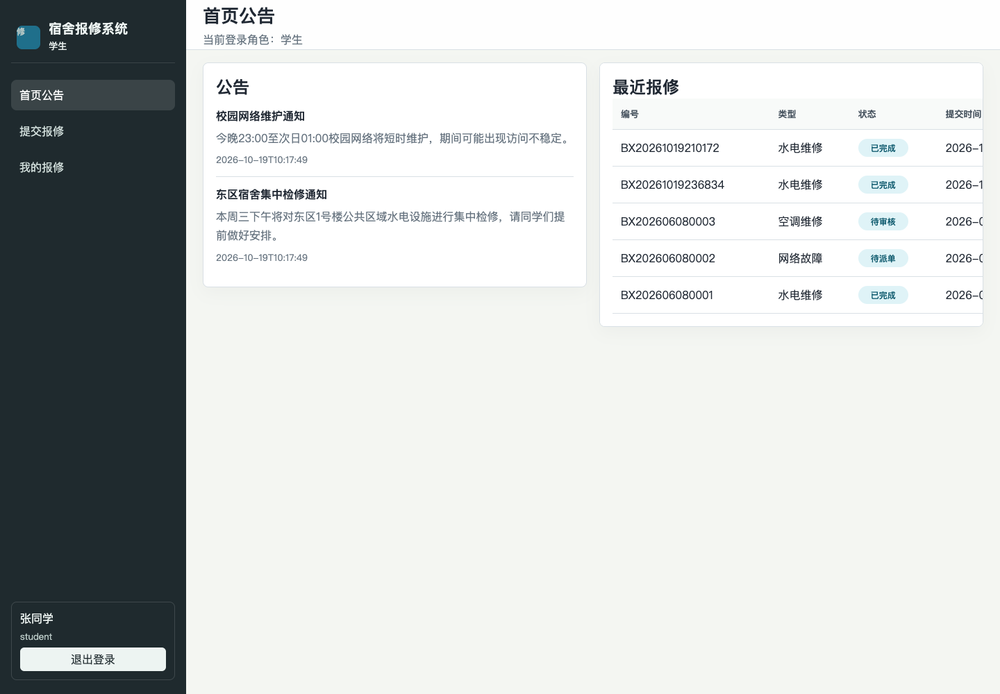
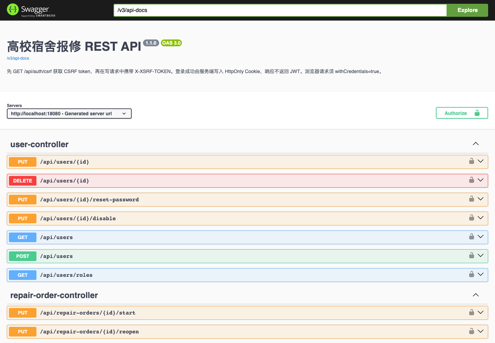

# 实验二 前后端分离与 RESTful API

姓名：________　学号：________　班级：________　实验日期：________

本实验验证 Vue 页面通过 Axios 调用 Spring Boot REST API，完成浏览器登录与用户管理，并核对接口字段、跨域策略和错误边界。

## 实验环境与结构

前端为 Vue 3、Vue Router、Axios 和 Vite；后端为 Spring Boot。前端运行于 `http://localhost:5173`，后端默认运行于 `http://localhost:8080`。Cookie 登录要求两端使用一致主机名，不能一端用 localhost 而另一端用 127.0.0.1。

## 操作步骤

1. 前端目录执行 `npm ci`，再执行 `npm run build` 和 `npm run dev`。
2. 启动后端，在登录页面设置实际 API 地址。
3. Axios 使用 `withCredentials: true`，浏览器自动携带服务端签发的 Cookie。
4. 每次写请求先调用 `GET /api/auth/csrf`，随后将响应 token 放入 `X-XSRF-TOKEN` 请求头。
5. 登录后进入角色工作台，完成查询与报修操作；刷新浏览器，通过 `/api/auth/me` 恢复身份。
6. 打开 `/swagger-ui/index.html` 核对接口；OpenAPI JSON 位于 `/v3/api-docs`。
7. 验证允许来源的预检请求成功，非允许来源被拒绝；验证无登录 401、越权 403、无效表单 400。

## 关键实现

- `frontend/src/services/api.js`：统一 baseURL、Axios 凭证、CSRF 头和错误信息。
- `frontend/src/store/auth.js`：身份仅保存在运行时内存，不将 JWT 写入浏览器存储。
- `frontend/src/main.js`：挂载前通过后端恢复当前用户。
- `SecurityConfig.java`：指定允许跨域来源与凭证；不使用通配来源配合 Cookie。
- `OpenApiConfig.java`：描述 Cookie 认证、CSRF 请求头和错误状态；字段来自真实 Controller/DTO。

接口成功响应统一为 `{ "code": 200, "message": "操作成功", "data": ... }`；失败使用对应 HTTP 状态及统一业务结构。请求参数校验不回显密码或完整请求体。前端的角色路由用于交互，后端权限判断才决定请求能否执行。

## 字段与错误边界核对

| 接口 | 主要字段或响应 | 边界 |
|---|---|---|
| POST `/api/auth/login` | username、password；响应 user | 错误密码 401；无 CSRF 403；JWT 只写 Cookie |
| POST `/api/users` | username、password、name、roleId | 普通学生 403；无效参数 400 |
| PUT `/api/users/{id}` | name、roleId、status 等 | 无效角色、状态或移除最后一个管理员 400 |
| POST `/api/repair-orders` | categoryId、dormRoomId、description、contactPhone | 缺少必填字段 400 |
| GET `/api/auth/me` | 当前用户安全字段 | 匿名或无效 JWT 401 |

完整参数与模型见 [OpenAPI 快照](../openapi.json)，实际运行接口为最终依据。

## 验证与截图

构建结果、浏览器验证和跨域用例见 [验证总表](../验证结果.md)，HTTP 明细见 [接口验证记录](../evidence/api-verification.json)。

本次实际结果：后端19项自动测试通过，独立MySQL上24项HTTP检查通过，浏览器9项检查通过，前后端构建及jar启动通过。完整统计保存在同目录上级的验证材料中。

## 总结与反思

分离部署需要同时处理浏览器凭证、跨域和 CSRF，单独配置 CORS 不能完成安全登录。前端构建通过只能证明依赖和打包正常，需要真实浏览器再次验证 Cookie、刷新恢复和退出。自动生成接口文档减少字段漂移，但仍需要将参数、返回值与实际 HTTP 验证结果对照。

## 本人应能讲解的内容

解释 Axios、REST JSON、CORS 预检和 withCredentials；区分 400、401、403；说明页面刷新后如何恢复用户，以及为什么前端不再读取 JWT。

## AI 工具使用记录

本次补充使用 Codex。使用环节包括缺口核对、认证配置、测试代码、接口说明与报告整理。主要任务指令为“补齐个人实验一、二、四，排除实验三和五”，并要求保留报修业务、使用真实运行结果。新增关键实现及测试包含 `AI-assisted` 注释。

验证采用 Maven 自动化测试、前端生产构建、真实独立 MySQL 数据库上的 HTTP 联调，以及浏览器操作与截图。AI 产出经测试检查，但测试不能证明提交者已理解代码。提交前需本人核对报告内容，并能讲解报告列出的关键代码；个人学习经历、姓名、学号与签名由本人填写，不由工具代填。
