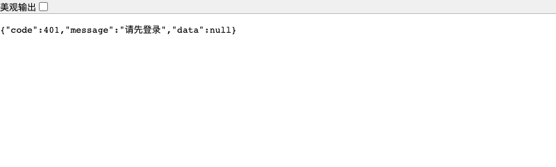

# 实验四 登录 权限与安全

姓名：________　学号：________　班级：________　实验日期：________

本实验实现 Spring Security、JWT、BCrypt 和基于角色及权限的访问控制，并验证令牌篡改、匿名访问、越权和跨站请求伪造边界。本次范围不包含实验五的大模型调用，因此不虚构模型提示注入测试结果。

## 数据与认证设计

用户表 `user` 关联角色表 `role`；`permission` 保存权限编码，`role_permission` 保存授权关系。用户管理、日志和统计使用数据库权限，报修及公告写操作使用 `@PreAuthorize` 角色校验，业务 Service 继续检查工单归属和状态。

JWT 采用 HS256，包含 issuer、subject、issuedAt、expiresAt、username 和 role。服务端使用 Nimbus 验证签名、有效期与签发者。密钥从 `JWT_SECRET` 读取，少于32字节拒绝启动。JWT 属于签名格式，载荷可解码，不能放入密码、手机号等敏感资料。

## 操作步骤

1. 新建独立实验数据库并导入初始化脚本，或对现有数据库执行权限迁移。
2. 设置环境变量，启动后端；生产 HTTPS 环境设置 `COOKIE_SECURE=true`。
3. 调用 `/api/auth/csrf`，保留 Cookie 和 CSRF token；在登录请求中带 `X-XSRF-TOKEN`。
4. 登录成功时服务端写入 `DORM_AUTH` HttpOnly、SameSite=Lax Cookie。登录 JSON 不返回 JWT。
5. Spring Security 过滤器验证 JWT，并重新查询当前账号状态、角色与权限。账号禁用、角色变更在后续请求中生效。
6. 访问用户管理和公告写接口，分别验证数据库权限和方法角色校验。
7. 退出时后端清除 Cookie；刷新页面后不再恢复用户身份。

## 关键代码说明

| 文件 | 关键行为 |
|---|---|
| `TokenService.java` | 标准 JWT 签发；拒绝伪造、过期和非法令牌 |
| `JwtAuthenticationFilter.java` | 加载实时账号和权限，设置 Spring Security 与业务用户上下文，请求结束清理 |
| `SecurityConfig.java` | 过滤器链、方法授权、CSRF、CORS、JSON 401/403 |
| `AuthController.java` | Cookie 签发与清除、CSRF 获取、当前身份 |
| `WebConfig.java` | BCryptPasswordEncoder |
| `RoleMapper.java` | 查询 role_permission / permission 授权 |
| `UserAdminService.java` | 密码哈希、最后一个管理员保护和状态约束 |

## 安全测试

- JWT：正常往返、不同密钥伪造、过期、非法格式、弱密钥拒绝。
- HTTP：匿名请求、伪造 JWT、禁用账号、学生越权、方法角色校验、无 CSRF 写请求、允许与非允许 CORS 来源。
- 真实数据库：用户 CRUD、最后一个管理员禁止降权、无效表单、退出后身份失效和报修完整流程。
- 浏览器：确认登录 Cookie 为 HttpOnly，localStorage 无 JWT；刷新恢复身份、退出后回到登录页。

具体结果见 [验证总表](../验证结果.md) 与 [HTTP 明细](../evidence/api-verification.json)。

本次实际结果：后端19项自动测试通过，独立MySQL上24项HTTP检查通过，浏览器9项检查通过，前后端构建及jar启动通过。

## 安全边界与反思

HttpOnly 减少脚本直接读取登录凭证的机会，不能代替输入校验和 XSS 防护；Cookie 自动发送，因此写接口还需要 CSRF 校验。角色限制不能替代数据归属校验。用户密码以 BCrypt 单向哈希保存，签名密钥和数据库密码从环境注入，不在源码中写真实值。

本次没有大模型输入链路，不执行实验五相关功能；以后接入模型时，仍需单独验证提示注入、敏感信息脱敏和幻觉。退出会清除当前浏览器 Cookie，不提供已窃取 JWT 的集中撤销机制；演示版本令牌按有效期失效，生产可增加撤销列表或凭证版本。

## 本人应能讲解的内容

解释 JWT 三段结构和签名校验；区分 BCrypt 与加密；说明 Cookie、SameSite、Secure、HttpOnly 和 CSRF 的作用；演示学生访问用户管理得到403；说明 Service 如何避免跨用户操作工单。

## AI 工具使用记录

本次补充使用 Codex。使用环节包括缺口核对、认证配置、测试代码、接口说明与报告整理。主要任务指令为“补齐个人实验一、二、四，排除实验三和五”，并要求保留报修业务、使用真实运行结果。新增关键实现及测试包含 `AI-assisted` 注释。

验证采用 Maven 自动化测试、前端生产构建、真实独立 MySQL 数据库上的 HTTP 联调，以及浏览器操作与截图。AI 产出经测试检查，但测试不能证明提交者已理解代码。提交前需本人核对报告内容，并能讲解报告列出的关键代码；个人学习经历、姓名、学号与签名由本人填写，不由工具代填。
